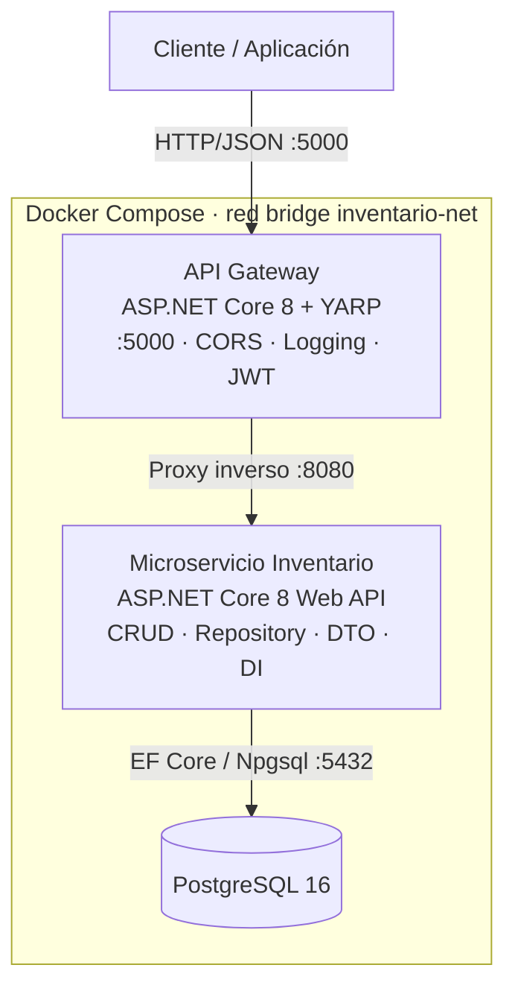

# Inventario API — API Gateway + Microservicio de Inventario

Examen Práctico Evaluativo: arquitectura orientada a servicios con un **API Gateway (proxy inverso)** y un **microservicio backend** conectado a una base de datos relacional, todo orquestado con **Docker Compose**.

- **Dominio:** Control de Inventario (productos, categorías y movimientos de stock).
- **Tecnología backend asignada:** NetCore API (C# .NET 8).
- **Base de datos:** PostgreSQL 16.
- **Gateway:** ASP.NET Core 8 + [YARP](https://microsoft.github.io/reverse-proxy/).

## Arquitectura



Solo el gateway publica un puerto al exterior (`5000`). El microservicio y la base de datos viven únicamente dentro de la red `inventario-net`.

Los diagramas C4 (nivel 1 Contexto y nivel 2 Contenedores) están en [`docs/diagramas`](docs/diagramas).

### Características transversales del gateway

| Característica | Detalle |
|---|---|
| Validación de tokens JWT | Las rutas `/api/**` exigen `Authorization: Bearer <token>`. El token se obtiene en `POST /auth/login`. |
| CORS | Política `frontend` con orígenes configurables en `Cors:Origenes` (`appsettings.json`). |
| Logging centralizado | Cada petición registra método, ruta, IP, estado y duración, con un `X-Correlation-Id` que viaja al microservicio y vuelve en la respuesta. |

### Patrones del microservicio

- **Repository** (`IRepository<T>` + repositorios específicos) sobre Entity Framework Core.
- **DTO** para entrada y salida, con validación mediante Data Annotations.
- **Inyección de dependencias** de repositorios y servicios.
- **Capa de servicios** con las reglas de negocio.
- **Middleware de excepciones** que traduce errores a respuestas `ProblemDetails` (400, 404, 409 y 500).

## Estructura del repositorio

```
InventarioApi/
├── docker-compose.yml
├── .env.example
├── docs/diagramas/              Diagramas C4
└── src/
    ├── ApiGateway/              Gateway YARP (Dockerfile incluido)
    └── InventarioService/       Microservicio (Dockerfile incluido)
        ├── Controllers/
        ├── Services/
        ├── Repositories/
        ├── Models/
        ├── Dtos/
        ├── Data/
        ├── Mappings/
        ├── Middleware/
        └── Exceptions/
```

## Requisitos

- [Docker](https://www.docker.com/) con Docker Compose v2.
- Git.
- Opcional, solo para ejecutar sin Docker: .NET SDK 8.

## Cómo clonar y ejecutar

```bash
git clone https://github.com/ignaciosanga/inventario-api.git
cd inventario-api
docker compose up --build
```

Para ejecutarlo en segundo plano: `docker compose up --build -d`.

Cuando `docker compose ps` muestre los tres contenedores como `healthy`, el sistema está listo:

| URL | Descripción |
|---|---|
| `http://localhost:5000/health` | Estado del gateway |
| `http://localhost:5000/servicio/health/db` | Estado del microservicio y su conexión a la base de datos |
| `http://localhost:5000/swagger` | Swagger del microservicio, a través del gateway |
| `http://localhost:5000/auth/login` | Obtención del token JWT |
| `http://localhost:5000/api/...` | API protegida |

Para detener todo: `docker compose down` (conserva los datos). Para borrar también la base de datos: `docker compose down -v`.

### Variables de entorno

El compose funciona sin configurar nada. Para cambiar valores, copia `.env.example` a `.env`:

| Variable | Valor por defecto |
|---|---|
| `POSTGRES_DB` | `inventario` |
| `POSTGRES_USER` | `postgres` |
| `POSTGRES_PASSWORD` | `postgres` |
| `JWT_KEY` | clave de ejemplo (mínimo 32 caracteres) |
| `AUTH_USUARIO` | `admin` |
| `AUTH_CLAVE` | `admin123` |

> Las credenciales por defecto son solo para el examen. En un entorno real deben cambiarse.

## Endpoints

Todas las rutas `/api/**` requieren el token JWT.

### Autenticación

| Verbo | URL | Descripción |
|---|---|---|
| POST | `/auth/login` | Devuelve un token JWT |

```json
{ "usuario": "admin", "clave": "admin123" }
```

### Categorías

| Verbo | URL | Descripción | Respuestas |
|---|---|---|---|
| GET | `/api/categorias` | Lista las categorías | 200 |
| GET | `/api/categorias/{id}` | Obtiene una categoría | 200, 404 |
| POST | `/api/categorias` | Crea una categoría | 201, 400, 409 |
| PUT | `/api/categorias/{id}` | Actualiza una categoría | 200, 400, 404, 409 |
| DELETE | `/api/categorias/{id}` | Elimina una categoría | 204, 404, 409 si tiene productos |

```json
{ "nombre": "Accesorios", "descripcion": "Perifericos" }
```

### Productos

| Verbo | URL | Descripción | Respuestas |
|---|---|---|---|
| GET | `/api/productos` | Lista los productos | 200 |
| GET | `/api/productos/{id}` | Obtiene un producto | 200, 404 |
| GET | `/api/productos/{id}/movimientos` | Historial de movimientos del producto | 200, 404 |
| POST | `/api/productos` | Crea un producto | 201, 400, 404, 409 |
| PUT | `/api/productos/{id}` | Actualiza un producto (el stock cambia solo con movimientos) | 200, 400, 404, 409 |
| DELETE | `/api/productos/{id}` | Elimina un producto y sus movimientos | 204, 404 |

```json
{ "codigo": "MOU-001", "nombre": "Mouse", "descripcion": "Mouse USB", "precio": 120.50, "stock": 20, "categoriaId": 1 }
```

### Movimientos

| Verbo | URL | Descripción | Respuestas |
|---|---|---|---|
| GET | `/api/movimientos` | Lista los movimientos | 200 |
| GET | `/api/movimientos/{id}` | Obtiene un movimiento | 200, 404 |
| POST | `/api/movimientos` | Registra una entrada o salida y actualiza el stock | 201, 400, 404 |

```json
{ "productoId": 1, "tipo": "Salida", "cantidad": 3, "motivo": "Venta" }
```

`tipo` acepta `Entrada` o `Salida`. Una salida con más unidades que el stock disponible responde `400`.

## Cómo probar el sistema

### Con cURL (Linux, macOS o Git Bash)

```bash
curl -s http://localhost:5000/health

curl -i http://localhost:5000/api/categorias

TOKEN=$(curl -s -X POST http://localhost:5000/auth/login \
  -H "Content-Type: application/json" \
  -d '{"usuario":"admin","clave":"admin123"}' | sed -E 's/.*"token":"([^"]+)".*/\1/')

curl -s -X POST http://localhost:5000/api/categorias \
  -H "Authorization: Bearer $TOKEN" -H "Content-Type: application/json" \
  -d '{"nombre":"Accesorios","descripcion":"Perifericos"}'

curl -s -X POST http://localhost:5000/api/productos \
  -H "Authorization: Bearer $TOKEN" -H "Content-Type: application/json" \
  -d '{"codigo":"MOU-001","nombre":"Mouse","precio":120,"stock":20,"categoriaId":1}'

curl -s -X POST http://localhost:5000/api/movimientos \
  -H "Authorization: Bearer $TOKEN" -H "Content-Type: application/json" \
  -d '{"productoId":1,"tipo":"Entrada","cantidad":5,"motivo":"Reposicion"}'

curl -s -X POST http://localhost:5000/api/movimientos \
  -H "Authorization: Bearer $TOKEN" -H "Content-Type: application/json" \
  -d '{"productoId":1,"tipo":"Salida","cantidad":999}'

curl -s http://localhost:5000/api/productos -H "Authorization: Bearer $TOKEN"

curl -s http://localhost:5000/api/productos/1/movimientos -H "Authorization: Bearer $TOKEN"

curl -s -X PUT http://localhost:5000/api/productos/1 \
  -H "Authorization: Bearer $TOKEN" -H "Content-Type: application/json" \
  -d '{"codigo":"MOU-001","nombre":"Mouse inalambrico","precio":150,"categoriaId":1}'

curl -i -X DELETE http://localhost:5000/api/productos/1 -H "Authorization: Bearer $TOKEN"
```

### Con PowerShell (Windows)

```powershell
$login = Invoke-RestMethod -Method Post -Uri http://localhost:5000/auth/login -ContentType "application/json" -Body '{"usuario":"admin","clave":"admin123"}'
$h = @{ Authorization = "Bearer $($login.token)" }

Invoke-RestMethod http://localhost:5000/api/categorias -Headers $h
Invoke-RestMethod -Method Post -Uri http://localhost:5000/api/categorias -Headers $h -ContentType "application/json" -Body '{"nombre":"Accesorios","descripcion":"Perifericos"}'
```

### Con Postman o Swagger

- **Swagger:** abre `http://localhost:5000/swagger` (el Swagger no incluye el botón de autorización porque el JWT lo valida el gateway; usa Postman o cURL para las rutas `/api/**`).
- **Postman:** haz `POST /auth/login`, copia el `token` y en la pestaña *Authorization* de cada petición elige *Bearer Token*.

### Ver los logs

```bash
docker compose logs --no-log-prefix api-gateway
docker compose logs --no-log-prefix inventario-service
docker compose logs --no-log-prefix db --tail 20
```

## Ejecución local sin Docker (desarrollo)

Se necesita una instancia de PostgreSQL. Con Docker, solo la base de datos:

```bash
docker run -d --name pg-inventario -e POSTGRES_PASSWORD=postgres -e POSTGRES_DB=inventario -p 5433:5432 postgres:16-alpine
```

En una terminal, el microservicio (puerto 5204):

```bash
export ConnectionStrings__Default="Host=localhost;Port=5433;Database=inventario;Username=postgres;Password=postgres"
dotnet run --project src/InventarioService --launch-profile http
```

En otra terminal, el gateway (puerto 5000):

```bash
dotnet run --project src/ApiGateway --launch-profile http
```

En PowerShell, la variable se define con `$env:ConnectionStrings__Default="..."`.

## Flujo de ramas (Git Flow)

- `main`: versión estable y entregable.
- `develop`: integración.
- `feature/microservicio-datos`: modelos, DbContext, DTOs y repositorios.
- `feature/microservicio-api`: servicios, controllers, middleware, Swagger y health.
- `feature/api-gateway`: gateway con YARP, JWT, CORS y logging.
- `feature/docker`: Dockerfiles y `docker-compose.yml`.
- `docs/readme`: documentación.

Cada rama se integra a `develop` con `merge --no-ff`, y `develop` pasa a `main` al cierre.
